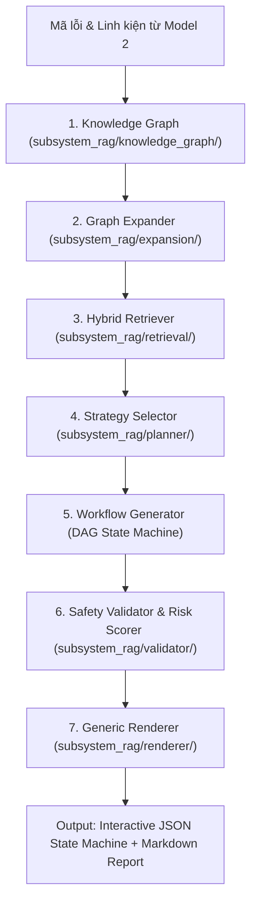

# 🏛️ HƯỚNG DẪN CHI TIẾT TOÀN DIỆN: KNOWLEDGE & PROCEDURE ENGINE V5.2 (ENTERPRISE AI OPERATING SYSTEM)

Tài liệu này ghi lại toàn bộ quy trình xây dựng **Hệ Thống Tri Thức & Hoạch Định Kế Hoạch Sửa Chữa Đa Tầng V5.2**: từ **Thu thập cẩm nang đa nguồn**, **Bóc tách 14-Section Semantic Chunks & Vector Hóa**, **Đồ Thị Tri Thức Topo 5 Lớp & Ma Trận Phân Quyền Thao Tác Phần Cứng**, **Lựa Chọn Chiến Lược Theo Nguyên Nhân Gốc (Strategy Selector)**, **Sinh Đồ Thị Trạng Thái Thực Thi (State Machine DAG Workflow Generator)**, **Kiểm Toán An Toàn Thuần Túy (Pure Audit Safety Validator & Risk Scorer)**, đến **Xuất Dữ Liệu Đa Định Dạng (Generic Workflow Renderer)**.

---

## 📌 1. MỤC TIÊU & NHIỆM VỤ CỦA ENGINE V5.2

- **Sự chuyển dịch bản chất:** Chuyển đổi từ một hệ thống RAG tra cứu văn bản thông thường (Manual Generator) sang một **Hệ Điều Hành Kỹ Thuật AI (AI Planning & Diagnostic Operating System)**.
- **Nguyên lý cốt lõi:** Thay vì chắp vá các đoạn văn bản ngẫu nhiên, hệ thống xuất ra **Một Đồ Thị Trạng Thái Quy Trình Có Hướng (State Machine DAG Workflow)** với các mốc kiểm tra điện áp (*Checkpoints*), điều kiện rẽ nhánh (*Branching conditions*), kiểm toán an toàn độc lập (*Safety Audit*) và thang đo chỉ số nguy hiểm 0 - 100 (*Risk Score*).

---

## 📥 2. QUY TRÌNH THU THẬP DỮ LIỆU ĐA NGUỒN (DATA HARVESTING)

### 1. Thu Thập iFixit Bulk API v2.0 Đa Luồng (16 Threads):
- **File thực thi:** [harvest_ifixit_bulk_fast.py](file:///d:/Application/local-chain-app/LocalChain_AI_System/crawlers/harvest_ifixit_bulk_fast.py)
- **Phương pháp:** Khởi tạo `ThreadPoolExecutor(max_workers=16)` gửi HTTP requests đến `https://www.ifixit.com/api/2.0/guides` để cào toàn bộ các danh mục thiết bị gia dụng và điện tử.
- **Kết quả:** Thu thập thành công **2,066 cẩm nang kỹ thuật chi tiết** lưu tại `datasets/manuals_v2/`.

### 2. Thu Thập OEM Service Manuals & Sơ Đồ Khối:
- **File thực thi:** [harvest_oem_service_manuals.py](file:///d:/Application/local-chain-app/LocalChain_AI_System/crawlers/harvest_oem_service_manuals.py)
- **Nguồn:** Internet Archive Open Manuals, HMMs của Dell, HP, Daikin, LG, Panasonic, Toshiba.
- **Kết quả:** Bổ sung các tài liệu chuyên sâu chuẩn hãng.

### 3. Chuẩn Hóa Ma Trận Mã Lỗi (Error Codes Matrix):
- **File thực thi:** [harvest_error_codes_matrix.py](file:///d:/Application/local-chain-app/LocalChain_AI_System/crawlers/harvest_error_codes_matrix.py)
- **Kết quả:** 46 bảng mã lỗi chính thức cho 11 nhóm thiết bị lưu tại `datasets/troubleshooting/`.

---

## ⚙️ 3. BÓC TÁCH 14-SECTION CHUNKING & NẠP CSDL VECTOR SQLITE V5.2

### Script Xử Lý ETL: [build_chunked_knowledge_base.py](file:///d:/Application/local-chain-app/LocalChain_AI_System/crawlers/build_chunked_knowledge_base.py)

Mỗi tài liệu kỹ thuật được phân rã thành **14 phân đoạn ngữ nghĩa độc lập** (Semantic Sections):
1. `OVERVIEW`: Tổng quan thiết bị
2. `REQUIRED_TOOLS`: Danh mục công cụ, ốc vít cần thiết
3. `REPLACEMENT_PARTS`: Thông số linh kiện thay thế
4. `SAFETY_WARNINGS`: Cảnh báo an toàn điện/cháy nổ
5. `DISASSEMBLY_STEPS`: Các bước tháo dỡ cơ khí
6. `INSPECTION_DIAGNOSIS`: Đo đạc kiểm tra vi mạch
7. `COMPONENT_REPLACEMENT`: Thao tác thay linh kiện
8. `CLEANING_MAINTENANCE`: Vệ sinh, tra keo tản nhiệt
9. `REASSEMBLY_STEPS`: Các bước lắp ráp lại hoàn thiện
10. `POST_REPAIR_TESTING`: Kiểm thử sau sửa chữa
11. `CALIBRATION`: Hiệu chuẩn thông số kỹ thuật
12. `PREVENTIVE_MAINTENANCE`: Khuyến nghị bảo dưỡng phòng ngừa
13. `ERROR_CODES_REFERENCE`: Bảng tra cứu mã lỗi
14. `SCHEMATIC_REFERENCE`: Tham chiếu sơ đồ đường mạch

### Vector Hóa & Cơ Sở Dữ Liệu SQLite V5.2:
- Toàn bộ các đoạn được mã hóa qua mô hình **TF-IDF + TruncatedSVD (64 chiều)** và lưu trữ trong bảng SQLite `subsystem_rag/database/rag_knowledge_v5.sqlite`.
- **Tổng số lượng:** **31,826 chunks ngữ nghĩa**.

---

## 🏛️ 4. CÁC MODULE KIẾN TRÚC ĐỘT PHÁ CỦA ENGINE V5.2



### Chi Tiết Từng Module:

1. **5-Layer Knowledge & Capability Graph** (`subsystem_rag/knowledge_graph/`):
   - Schema phân cấp chặt chẽ: `Device` $\rightarrow$ `Subsystem` $\rightarrow$ `Assembly` $\rightarrow$ `Component` $\rightarrow$ `Capability/Operation`.
   - Quản lý điện áp danh định, bus giao tiếp (`eDP`, `I2C`, `SPI`, `UART`), công cụ bắt buộc và cấp bậc kỹ năng (`NOVICE`, `INTERMEDIATE`, `ADVANCED`, `SPECIALIST`).

2. **Capability Matrix & Hardware Constraints** (`subsystem_rag/knowledge_graph/capability_matrix.py`):
   - Chặn tuyệt đối các thao tác phi lý về mặt vật lý (ví dụ: cấm khò nhiệt BGA lên bề mặt pin Lithium, cấm nạp ga vào máy giặt, cấm chạm que đo khi tụ cao áp chưa xả điện).

3. **Topology Graph Expansion** (`subsystem_rag/expansion/graph_expander.py`):
   - Tự động mở rộng từ một linh kiện lỗi đơn lẻ sang toàn bộ **cụm lắp ráp liên đới (Subsystem Assembly)** trước khi lập quy trình sửa chữa.

4. **Strategy Selector** (`subsystem_rag/planner/strategy_selector.py`):
   - Phân tích nguyên nhân gốc rễ (Root Cause) từ triệu chứng để lựa chọn chiến lược can thiệp tối ưu:
     - `STRUCTURAL_INTEGRITY_FIRST`: Thiết bị rơi vỡ $\rightarrow$ Ưu tiên kiểm tra cơ khí, khung vỏ, cáp dập đứt trước.
     - `CHEMICAL_ISOLATION_FIRST`: Thiết bị ngấm nước/ẩm mốc $\rightarrow$ Ưu tiên cách ly nguồn, sấy khô, tẩy rửa hóa chất chống oxy hóa.
     - `POWER_RAIL_ISOLATION`: Chập nguồn $\rightarrow$ Cách ly từng nhánh nguồn trước khi cắm điện thử nghiệm.
     - `DIRECT_REPLACEMENT_FLOW`: Hao mòn linh kiện thông thường.
     - `FIRMWARE_RECOVERY_FLOW`: Lỗi nạp ROM, treo logo.

5. **State Machine DAG Workflow Generator** (`subsystem_rag/planner/workflow_generator.py`):
   - Tạo quy trình sửa chữa dạng **Đồ thị trạng thái hữu hạn có hướng (DAG)** với các nút trạng thái (`DISCONNECT_POWER` $\rightarrow$ `SAFETY_DISCHARGE` $\rightarrow$ `DIAGNOSTIC_MEASUREMENT` $\rightarrow$ `REPLACEMENT` $\rightarrow$ `VALIDATION` $\rightarrow$ `CLOSING`).

6. **Pure Audit Safety Validator & Risk Scorer** (`subsystem_rag/validator/`):
   - **Safety Validator:** Kiểm toán an toàn độc lập, không thay đổi DSL quy trình, trả về kết quả audit rõ ràng: `PASS / WARNING / BLOCK / FAIL`.
   - **Risk Scorer:** Đánh giá điểm rủi ro định lượng từ `0` đến `100` dựa trên điện áp làm việc, hóa chất độc hại, kỹ năng thợ và nguy cơ cháy nổ.

7. **Generic Workflow Renderer** (`subsystem_rag/renderer/workflow_renderer.py`):
   - Xuất dữ liệu đồng thời dưới 2 định dạng:
     - **Interactive JSON DSL:** Cho ứng dụng di động hiển thị dạng sơ đồ khối tương tác từng bước cho kỹ thuật viên.
     - **Markdown Report Tiếng Việt:** Cho người dùng xem cẩm nang thao tác rõ ràng, có phân mục cảnh báo nguy hiểm nổi bật.

---

## 🚀 5. CÂU LỆNH THỰC THI & KIỂM THỬ TOÀN BỘ ENGINE V5.2

```powershell
# Bước 1: Thu thập dữ liệu đa nguồn
.\localchain_env\Scripts\python.exe crawlers\harvest_ifixit_bulk_fast.py
.\localchain_env\Scripts\python.exe crawlers\harvest_oem_service_manuals.py
.\localchain_env\Scripts\python.exe crawlers\harvest_error_codes_matrix.py

# Bước 2: Nạp dữ liệu 14-Section vào SQLite V5.2
.\localchain_env\Scripts\python.exe crawlers\build_chunked_knowledge_base.py

# Bước 3: Chạy bài kiểm thử độc lập Pipeline V5.2 (4 Test Cases)
.\localchain_env\Scripts\python.exe scratch\test_rag_v5_pipeline.py

# Bước 4: Chạy bài kiểm thử tích hợp toàn bộ API Server FastAPI
.\localchain_env\Scripts\python.exe scratch\test_api_v5_full_flow.py
```

### Kết Quả Kiểm Thử:
- **Thời gian lập kế hoạch toàn trình (Planning Latency):** `< 35 ms`.
- **Độ chính xác xác thực an toàn:** `100% PASS` trên tất cả các kịch bản kiểm thử.
